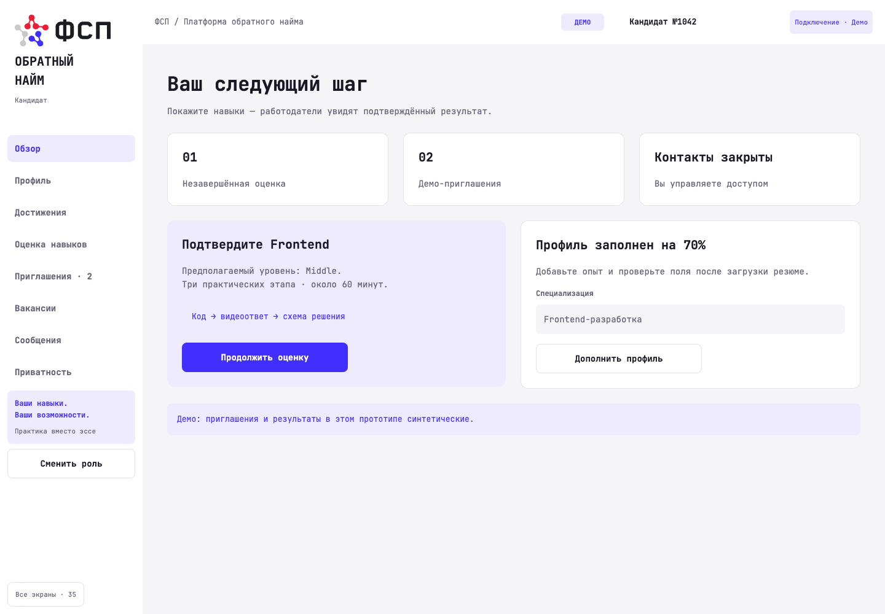
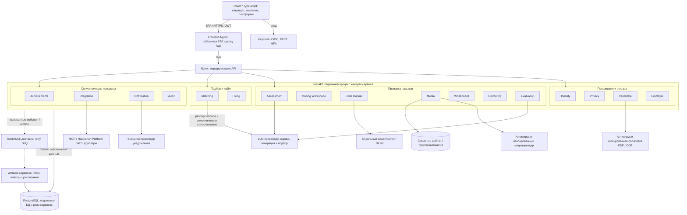

# Reverse HR

Платформа обратного найма IT-специалистов: кандидат подтверждает навыки заданиями, а компания находит подходящих специалистов и приглашает их с заранее указанными условиями и зарплатой. Проект разработан для специального трека ФСП; в репозитории находятся фронтенд, серверные сервисы, инфраструктура и тесты.

Основной сценарий: **профиль → специализация и целевой грейд → проверка навыков → автоматическое подтверждение или перепроверка человеком → подбор → приглашение или самостоятельный отклик → общение и найм**. Самоописание кандидата хранится отдельно от подтверждённых навыков; контакты раскрываются по согласию.



*Кабинет кандидата в демонстрационном режиме;*

## Продуктовый функционал

| Область | Возможности |
| --- | --- |
| Профиль и резюме | До десяти активных специализаций с отдельными заявленными и подтверждёнными грейдами, ожидания по зарплате, формат работы и доступность. Загрузка PDF, извлечение текста/OCR, подтверждение полей кандидатом, полное и обезличенное резюме с текстовым слоем. |
| Проверка навыков | Задания с кодом, SQL, видео, голосом и доской. Выбор утверждённых вариантов, сохранение версий ответа, скрытые тесты, ограничения попыток и cooldown. |
| Оценка и апелляции | Проверяемые доказательства Runner, подключаемая оценка LLM, калибровка и итоговые баллы. Автоматический грейд по утверждённой шкале, перепроверка человеком, независимый пересмотр, обоснование решений и история изменений. |
| Подбор | Поиск по специализации, подтверждённому грейду и компетенциям; зарплата, формат работы и доступность. Разбор запроса компании, уточнения и объяснение соответствия кандидата требованиям. |
| Вакансии и найм | Редактирование, модерация, публикация и архивирование вакансий. Приглашения с зарплатной вилкой, принятие/отказ, самостоятельные отклики, статусы, диалоги, раскрытие разрешённых контактов и передача в ATS. |
| Задания компаний | Конструктор всех форматов, назначение, прохождение, оценка и доступ к разрешённому результату. Добровольные подписки, разовые и регулярные расписания, лимиты частоты и защита от дублей. |
| Достижения и интеграции | Импорт и подтверждение достижений, управление источниками и видимостью. Командные и индивидуальные результаты накапливают ограниченный бонус подбора. Демоадаптеры ФСП, Hackathon Platform и ATS (название источника задаётся при настройке интеграции); достижения дополняют профиль и не обязательны для участия. |
| Доверие и контроль | Верификация компаний, жалобы, отзывы, модерация и обжалование ограничений. Прокторинг, сигналы риска общения, сроки рассмотрения и эскалации. |
| Privacy и Audit | Отдельные согласия на публикацию, контакты, материалы и интеграции; отзыв доступа и проверка при скачивании. Выгрузка, исправление, ограничение и удаление данных; защищённый журнал действий и раскрытий. |
| Уведомления | Новые задания, сроки, результаты и события найма. Настройки кандидата, разделение служебных сообщений и маркетинга, внешняя доставка со статусами и повторными попытками. |

**Направления.** В формах доступны Backend, Frontend, Mobile, QA, DevOps/SRE, аналитика данных, Data Science/ML, UX/UI, Project Manager, Product Manager и Technical Manager; можно указать своё направление. Каждый грейд подтверждается отдельно; доступность тестирования зависит от опубликованных референсов и калибровки.

**Роли.** Кандидат управляет своим профилем, прохождением и согласиями. В компании владелец управляет организацией и участниками, рекрутер — подбором и наймом, технический эксперт — заданиями и разрешёнными результатами. На стороне платформы разделены управление контентом, проверка оценок, модерация компаний и достижений, Privacy, Audit, интеграции и техническое администрирование; чувствительные роли требуют MFA. Часть административных операций доступна через API.

**Достоверность оценки.** Сессия закрепляет версии заданий, рубрики и набор скрытых тестов. Runner получает отдельный допуск к конкретному отправленному снимку и передаёт подписанные результаты в Evaluation. Согласованные оценки LLM и проверенные тесты позволяют выдать грейд автоматически по калиброванной политике; пограничные и спорные случаи проверяет человек. В кабинете платформы доступна аналитика качества заданий: шкалы по грейдам, трёхцветные распределения, разделяющая сила и связь с результатами остальных заданий. Неуспешная попытка повышения не понижает уже подтверждённый грейд автоматически; сигналы прокторинга также требуют рассмотрения.

**Генерация заданий и автоматическая оценка.** Для кода, SQL, видео, голоса и доски можно создавать и изменять собственные версионируемые референсы: описание навыков, ограничения, параметры вариативности и критерии оценки. Перед пробной генерацией оператор подтверждает конкретную спецификацию; после проверок и публикации референса worker пополняет пул оригинальных заданий. Код и SQL проверяются Runner до выдачи. Автоматическая оценка дополняется выборочной перепроверкой и апелляциями; задания компаний не меняют общий грейд кандидата. Для включения нужны настроенный LLM-провайдер, экспертная калибровка и актуальный допуск Linux Runner. Подробнее — [механизм, интерфейсы и настройки](docs/automatic-assessment.md).

**Новые задания и дополнительная проверка.** Кандидат может подписаться на подходящие опубликованные задания по всем специализациям, уровню и стеку. Worker отправляет уведомления по отдельному согласию, с ограничением частоты и защитой от дублей. Бонус достижений уменьшается с возрастом (2 → 1 → 0 за два года), история сохраняется. Попытки вмешательства в инструкции ИИ и подтверждённые проблемы Proctoring накапливаются как сигналы риска: автоматическая оценка приостанавливается до независимой проверки, грейд автоматически не снижается.

**Справедливость подбора.** Matching учитывает подтверждённые результаты и условия работы, объясняет подбор и обрабатывает изменения грейда с защитой от повторных и запоздавших событий. Самоописание не превращается в проверенный навык; влияние подтверждённых достижений ограничено политикой подбора.

## Архитектура

Система состоит из 17 основных сервисов и трёх демоадаптеров (`demo-fsp`, `demo-hackathon-platform`, `demo-ats`). Ниже — карта компонентов; подробные связи и последовательности вынесены в [архитектурные схемы](docs/architecture-diagrams.md).



Сплошные стрелки показывают запросы или доступ к ресурсу, пунктирные — события. Стрелки к группам обозначают общий путь через gateway; конкретные межсервисные запросы показаны в подробных схемах. В локальном Compose БД сервисов размещены в одном экземпляре PostgreSQL; сервисы не читают чужие таблицы.


Бэкенд организован как монорепозиторий: каждый сервис имеет пакет в `src/reverse_hr/services/`, свою точку запуска, обработчики событий и миграции. Общие технические механизмы находятся в `shared/`, DTO — в `contracts/`, подписанные RPC — в `protocols/`. Сервисы запускаются отдельными процессами с собственными БД и ролями; общий образ и lock-файл зависимостей сохранены. Межсервисный обмен идёт через API и события, без прямых импортов чужой реализации. `platform/` отвечает за запуск и транспорт, `coordination/` — за общие процессы Privacy и сроки рассмотрения с явным выбором владельца данных. Подробнее — [структура бэкенда](docs/backend-structure.md). Их назначение:

| Группа | Сервисы |
| --- | --- |
| Пользователи и права | `identity`, `privacy`, `candidate`, `employer` |
| Проверка навыков | `assessment`, `coding-workspace`, `code-runner`, `media`, `whiteboard`, `proctoring`, `evaluation` |
| Найм | `matching`, `hiring` |
| Сопутствующие процессы | `achievements`, `integration`, `notification`, `audit` |

Авторизация — Keycloak OIDC с PKCE; права дополнительно зависят от членства в организации и актуальных согласий. Внутренние запросы и результаты подписываются Ed25519. RabbitMQ, transactional outbox/inbox и идемпотентные обработчики обеспечивают повторы после сбоев; команды используют `Idempotency-Key`, изменение версий — `If-Match`.

**Границы изоляции.** Недоверенный код выполняется на отдельном Linux-узле в NsJail с ограничениями ресурсов, seccomp и проверками изоляции. Медиа и PDF обрабатываются изолированно; предусмотрены антивирусная проверка, S3 для медиа и очистка резервных копий. Локальная инфраструктура включает Mailpit и демоадаптеры; внешние провайдеры подключаются отдельной конфигурацией.

**Стек:** Python 3.12/3.13, FastAPI, SQLAlchemy 2, Alembic; React 19, TypeScript 5, Vite 8; PostgreSQL 17, RabbitMQ 4, Keycloak 26, Nginx, Docker Compose. Проверки — pytest, Ruff и Playwright. Точные зависимости закреплены в [uv.lock](uv.lock), [requirements.lock](requirements.lock) и [frontend/package-lock.json](frontend/package-lock.json).

## Запуск через Docker на Linux

Нужны Docker Engine с Compose v2 и Git. Фронтенд и бэкенд собираются в контейнерах; Python и Node.js на хосте для этого запуска не нужны. На чистом стенде из корня проекта сначала подготовьте `.env` и `.secrets/`. Команды используют временный контейнер с зависимостями бэкенда:

```sh
docker build -t reverse-hr:local .
docker run --rm --user "$(id -u):$(id -g)" -v "$PWD:/workspace" -w /workspace \
  reverse-hr:local python scripts/configure.py
docker run --rm --user "$(id -u):$(id -g)" -v "$PWD:/workspace" -w /workspace \
  -e PYTHONPATH=/workspace/src reverse-hr:local python scripts/configure_events.py
docker compose -f compose.yaml -f compose.frontend.yaml --profile all up --build -d
docker compose -f compose.yaml -f compose.frontend.yaml --profile all ps
```

| Адрес на Linux-хосте | Назначение |
| --- | --- |
| `http://localhost:3000` | Собранный React-интерфейс в Nginx; API через `/api/` |
| `http://localhost:8000/<service>/docs` | Swagger сервиса, например `candidate` |
| `http://localhost:8080` | Keycloak; realm `reverse-hr`, клиент `reverse-hr-web` |
| `http://localhost:8025` | Mailpit: письма проверочного стенда |

Порты по умолчанию доступны через loopback Linux-хоста. Для публичного Linux-сервера настройте HTTPS reverse proxy к интерфейсу и отдельный домен Keycloak; согласуйте hostname, issuer и redirect URI клиента с публичными адресами. Внутренние API, PostgreSQL и RabbitMQ оставьте в закрытой сети. Фронтенд работает без Vite; Dockerfile выполняет сборку, а Nginx раздаёт файлы и проксирует API. Секреты находятся в `.env` и `.secrets/` и не должны попадать в Git.

**Runner настраивается отдельно:** выполнение недоверенного кода требует выделенного Linux-узла или отдельной Linux-VM с NsJail. Docker-контейнер API не заменяет эту среду. Provisioning и проверки находятся в [infra/runner/](infra/runner/) и [scripts/provision_runner.py](scripts/provision_runner.py). Профиль `all` включает автоматическую обработку доказательств и решений; внешние LLM-оценка и генерация, транскрипция и S3 включаются отдельно; для них нужны дополнительные настройки и профили.

На чистом стенде подготовьте пользователей, собственные референсы или контент и утверждённые политики. [Автоматическая оценка и генерация](docs/automatic-assessment.md) описывают редактор, калибровку и профили `llm`/`generation`. Проверьте `http://localhost:3000/health/live` и `/api/<service>/health/ready`; успешный запуск контейнеров сам по себе не подтверждает готовность всего сценария.

Для разработки на Linux установите Python 3.12/3.13, uv и Node.js 22, выполните `uv sync --frozen` и `cd frontend && npm ci`. API и workers запускаются из сервисных пакетов; примеры есть в [структуре бэкенда](docs/backend-structure.md). Для демонстрации интерфейса без бэкенда: `cd frontend && npm ci && VITE_BACKEND_MODE=demo npm run dev`; адрес — `http://127.0.0.1:5175`, данные демонстрационные.

**Обновление ранее настроенного стенда.** `configure.py` создаёт только новую `.env` и не перезаписывает существующую. При переходе на абстрактный адаптер выполните `PYTHONPATH=src uv run python scripts/upgrade_hackathon_platform.py`, затем `PYTHONPATH=src uv run python scripts/configure_events.py` и пересоберите контейнеры с `--remove-orphans`. Первая команда сохраняет прежнюю БД демоисточника и ключ, добавляя новые настройки; вторая обновляет доверенные идентификаторы. Миграция Achievements обновляет тип источника, сохраняя связи, результаты и пользовательские названия. Для контейнерного выполнения используйте временный образ и монтирование рабочего каталога, как выше.

## Проверки и готовность

```sh
# Бэкенд, из корня проекта
uv run pytest -q
uv run ruff check .

# Фронтенд
cd frontend
npm run build
# Chromium устанавливается для текущего пользователя Linux.
npx playwright install --with-deps chromium
npm test -- --config=playwright.linux.config.ts
```

[Linux-конфигурация Playwright](frontend/playwright.linux.config.ts) использует установленный Chromium без локального пути браузера из базового конфига. Проверки PostgreSQL/RabbitMQ запускаются через [scripts/integration_tests.py](scripts/integration_tests.py) на отдельном тестовом стенде; опубликованные схемы API находятся в [contracts](contracts/).

## Навигация по репозиторию

- [Архитектурные схемы](docs/architecture-diagrams.md) — развёртывание, структура кода, оценка, найм, Privacy и обработка файлов.

- [frontend/](frontend/) — интерфейс, клиент API и браузерные тесты; [src/reverse_hr/services/](src/reverse_hr/services/) — пакеты сервисов; [platform/](src/reverse_hr/platform/) — запуск и workers; [tests/](tests/) — серверные проверки.
- [compose.yaml](compose.yaml), [infra/](infra/) и [scripts/](scripts/) — инфраструктура, миграции, конфигурация и запуск.

- [Автоматическая оценка и генерация](docs/automatic-assessment.md), [структура бэкенда](docs/backend-structure.md).
