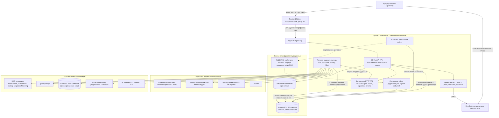
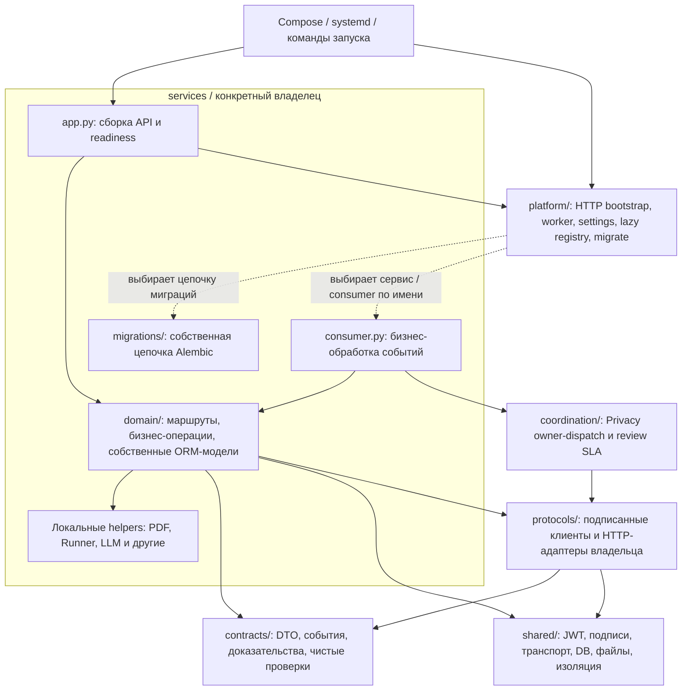
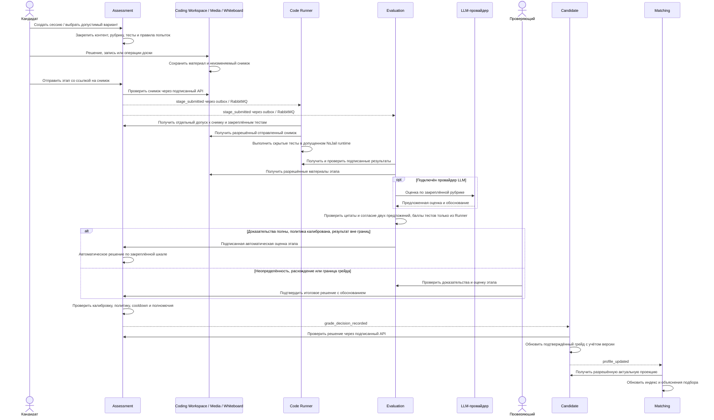
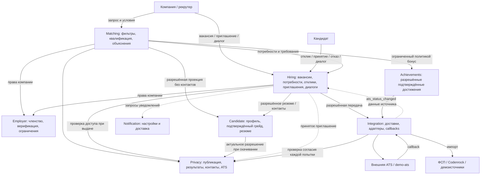
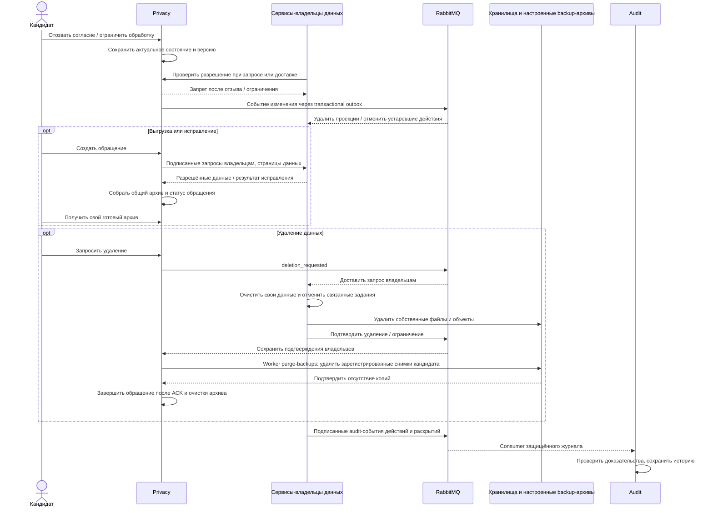
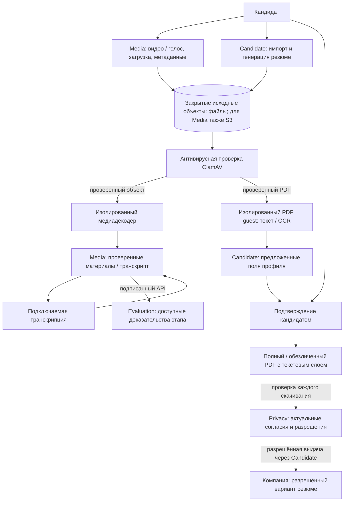
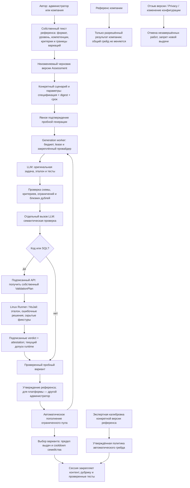

# Архитектура Reverse HR

Схемы описывают текущий код после реорганизации бэкенда. Обзор продукта и запуск — в [README](../README.md), расположение модулей — в [структуре бэкенда](backend-structure.md), правила доступа и владения — в [архитектурных правилах](architecture.md).

Система имеет 17 основных сервисов и три демосервиса: `demo-fsp`, `demo-codenrock`, `demo-ats`. У основных сервисов отдельные процессы, БД, роли доступа и миграции. Исходники, Docker-образ и зависимости общие; независимых версий сборки каждого сервиса пока нет. Схемы показывают логические границы, а не число физических серверов.

## 1. Развёртывание, транспорт и внешние зависимости

Сплошные стрелки — запросы и доступ к ресурсам; пунктирные — асинхронные события. API и workers используют только БД своего сервиса. RabbitMQ обеспечивает повторную доставку; outbox/inbox и бизнес-проверки нужны для безопасной обработки дублей и запоздавших изменений. Необработанные события доступны для диагностики и повторной обработки через очереди ошибок.

Docker-сценарий запускает собранный фронтенд через `compose.frontend.yaml`; Nginx фронтенда раздаёт SPA и проксирует `/api/` в gateway. В Compose PostgreSQL общий как сервер, но базы и роли разделены. Целевая среда развёртывания — Linux. Пользовательский код выполняется на выделенном Linux-узле или в отдельной Linux-VM; установка и подключение к платформе описаны в [Runner](../infra/runner/README.md), общий запуск — в [инструкции Linux](linux-deployment.md). Профиль `all` не подключает автоматически S3, LLM и транскрипцию. Демоисточники заменяют внешние API только на демонстрационном стенде. Mailpit принимает локальную почту, в том числе Keycloak; внешняя доставка Notification имеет отдельный HTTPS-протокол.

## 2. Структура кода и границы зависимостей

Стрелки показывают основные зависимости и сборку, а не полный граф Python-импортов. HTTP-адаптер протокола работает в процессе владельца и может использовать его локальные модели. Общая транспортная миграция находится в `platform/migrations/versions/`; бизнес-таблицы — в миграциях соответствующего сервиса. Старые revision IDs сохранены.

Прямые импорты реализации другого сервиса запрещены [архитектурными тестами](../tests/shared/test_architecture.py). `shared/` и `contracts/` не импортируют внутренние модули сервисов. Внутри `domain/` маршруты, ORM и бизнес-операции пока не полностью разделены на слои; перенос каталогов не означает завершённую переработку этой внутренней структуры.

## 3. Прохождение, доказательства, оценка и подтверждённый грейд

Пунктирные сообщения с именами событий проходят через брокер; остальные — действия пользователя или запросы. Для кода/SQL участвует Runner, для остальных форматов — соответствующие материалы и доказательства. Evaluation хранит оценки этапов и предложения LLM; Assessment владеет итоговым решением, правилами попыток и апелляциями. Candidate хранит подтверждённый грейд профиля, Matching — его поисковую проекцию.

Proctoring собирает сигналы от среды прохождения и клиента; результаты проверки самостоятельности доступны в процессе рассмотрения. Они не меняют грейд автоматически. Апелляция создаётся в Assessment, рассматривается независимым проверяющим с повторной проверкой доказательств и завершается новым решением либо сохранением прежнего. Изменённое решение проходит ту же цепочку Candidate → Matching; уведомления идут через Notification.

## 4. Подбор, вакансии, найм и интеграции

Публикацией вакансий, самостоятельными откликами и процессом найма владеет Hiring; Matching хранит поисковые проекции и подборки. Фильтры учитывают специализацию, грейд, требования, зарплату, формат работы и доступность. Принятие приглашения запускает оформление разрешения; выдача контактов и документов всё равно проверяет актуальный доступ. ATS получает только разрешённые данные, а её callbacks не обходят проверки переходов и версий.

Задания компаний находятся в Assessment: конструктор → назначение → прохождение → оценка → разрешённый результат. Подписки, разовые/регулярные расписания и лимиты обрабатывает worker Assessment; перед назначением проверяются актуальные права и согласия. События нового задания, срока и готового результата передаются в Notification. Технический эксперт компании получает только разрешённый результат, а не весь архив материалов кандидата.

## 5. Privacy, удаление, выгрузки и Audit

Оперативный запрет доступа основан на актуальной проверке Privacy, а не на ожидании доставки события. События очищают проекции и останавливают фоновые процессы; ответы владельцев позволяют отслеживать выполнение обращения. Выгрузка собирается через API с пагинацией, без SQL-доступа Privacy к чужим БД. Очистка управляемых резервных копий требует настройки поддерживаемых хранилищ и областей удаления; схема не означает автоматическую очистку любых внешних бэкапов.

Audit — отдельный consumer и сервис поиска истории с ограничениями доступа. Он сохраняет доказательства значимых действий и раскрытий; проверки Privacy применяются и к доступу к пользовательским данным журнала. Политики хранения, удаления и ограничения описаны в [Audit](audit-journal.md) и [обращениях Privacy](data-subject-requests.md).

## 6. Медиа, PDF и изолированная обработка

Это логический конвейер; декодеры работают с ограничениями сети, файловой системы и ресурсов. Непроверенные или отклонённые объекты не становятся доступными доказательствами. Согласие на запись не означает согласие на публикацию записи компании. Извлечённое самоописание подтверждается кандидатом и не превращается в проверенный навык; эти данные отделены от результата Assessment.

## Что схемы не подтверждают

Схемы описывают реализованные компоненты и механизмы подключения. Экспертная калибровка, утверждение рабочих политик, реальные LLM/транскрипция/внешние источники и полная приёмка стенда требуют данных и настройки. Реорганизация файлов не обновляет работающие контейнеры: необходима пересборка. Изменение исходников Linux Runner меняет fingerprint и требует повторных проверок и нового допуска runtime. Подробности — в [отчёте Runner](../infra/runner/LOCAL-VERIFICATION.md).

## 7. Генерация оригинальных заданий и пополнение пула

Без экспертной калибровки опубликованные задания платформы доступны для практики. Генерация не снимает маркировку demo. Точный порядок и настройки: [автоматическая оценка](automatic-assessment.md).
