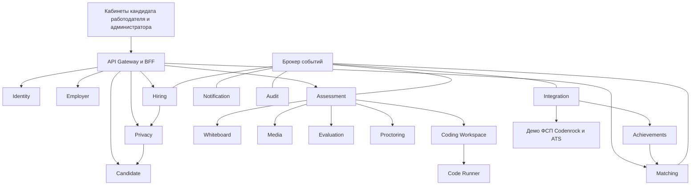

# План реализации платформы обратного найма ИТ специалистов

Дата: 5 октября 2026 года.

Статус: согласованное описание предлагаемого решения и план разработки. Документ не является отчётом об уже реализованных функциях или заключением о соответствии законодательству.

Основание: техническое задание «ФСП спец. трек ТЗ.pdf» и уточнения заказчика. В объём включены все функции исходного ТЗ, в том числе обозначенные в нём как необязательные для MVP или вынесенные за его рамки. Для внешних систем согласован демонстрационный режим: реализуются расширяемые контракты и работающие демоадаптеры ФСП, Codenrock и ATS на синтетических данных. Подключение реальных API не требуется для сдачи этого решения.

## 1. Концепция и принятые решения

Платформа связывает работодателей и кандидатов через подтверждённые компетенции. Кандидат выполняет практические задания, получает категорию и профиль навыков. Работодатель описывает потребность, видит объяснимую подборку и первым направляет предложение с обязательным диапазоном зарплаты. Контакты кандидата раскрываются конкретной компании после принятия приглашения или самостоятельного отклика.

Главный сценарий: регистрация → выбор специализации и предполагаемого грейда → практическая оценка → подтверждённая категория → подбор работодателем → приглашение с зарплатой → принятие → раскрытие контактов → передача разрешённых данных в ATS.

Ключевые решения:

1. Основная оценка строится на практических действиях. Вопросы с выбором ответа не входят в основное оценивание.
2. Обычного текстового ввода минимум: объяснения — через VCV или голос; код — в редакторе; проектирование — на доске.
3. VCV в этом документе означает асинхронный видеоответ кандидата. Обязательной интеграции с одноимённым внешним сервисом нет.
4. Самостоятельность прохождения проверяется через процесс работы, связанные уточнения и изменение условий. Обещания гарантированного обнаружения любого ИИ исключаются.
5. Общий подтверждённый грейд отделён от соответствия требованиям отдельной компании.
6. Задания генерируются в пределах проверенных семейств, компетенций и сложности.
7. Архитектура микросервисная: независимые приложения, владение данными и версионируемые контракты.
8. Согласия, права доступа, шифрование, удаление и аудит входят в основной объём разработки.
9. Поддерживаются достижения ФСП и других платформ через единый механизм интеграций.
10. Демонстрационные данные явно отделяются от реальных и не подтверждают квалификацию реальных пользователей.

По ТЗ обратный подбор составляет 35% оценки, тестирование и категоризация — 25%. Поэтому сначала собирается сквозная цепочка подтверждения навыков и приглашения, затем вокруг неё завершаются остальные возможности. Очерёдность не означает исключение функций из объёма.

## 2. Роли и кабинеты

| Роль | Возможности |
|---|---|
| Кандидат | Регистрация, подтверждение email, профиль, импорт резюме, выбор специализации и грейда, прохождение заданий, результаты и апелляции, достижения, приглашения, вакансии и отклики, сообщения, PDF, приватность и согласия |
| Работодатель | Организация и сотрудники, верификация, описание потребности, подборки, поиск, сравнение кандидатов, приглашения, вакансии и отклики, сообщения, конструктор заданий, интеграция с ATS |
| Администратор | Проверка работодателей, модерация, справочники, матрицы компетенций, банк заданий, версии тестов, предложения компаний, ручная оценка, апелляции, интеграции, аудит |

Внутри организации работодателя предусмотрены роли владельца, рекрутера и технического эксперта. Права администратора платформы также разделяются: модерация компаний, оценка кандидатов, управление контентом и техническое администрирование не требуют одинакового доступа.

Кандидат видит только свои данные и взаимодействия. Работодатель не получает доступ к чужим организациям. Полные записи прохождения доступны только уполномоченным проверяющим; работодателю по умолчанию предоставляются итог оценки и разрешённые доказательства.

Для всех кабинетов нужны адаптивная вёрстка, понятные пустые состояния, обработка ошибок, индикаторы фоновой обработки и сохранение прогресса. Перед медиаэтапом проверяются возможности устройства. Если требуемый режим не поддерживается, кандидат может продолжить с другого устройства без потери выполненной работы.

## 3. Модель квалификации и правила грейда

| Понятие | Значение |
|---|---|
| Заявленный грейд | Самооценка кандидата перед прохождением |
| Подтверждённый грейд | Уровень, установленный по общей процедуре платформы |
| Профиль компетенций | Результаты по отдельным навыкам со ссылками на доказательства |
| Соответствие компании | Результат сопоставления кандидата с конкретной потребностью |
| Актуальность | Давность и достаточность подтверждения навыка |
| Статус проверки самостоятельности | Завершена, требуется уточнение, ручная проверка или апелляция |

Категория определяется специализацией и подтверждённым грейдом. Отрасль, стек, формат работы и другие параметры используются для уточнения. Заявления в резюме не становятся подтверждёнными навыками автоматически.

Правила:

- До первого успешного прохождения грейд имеет статус «не подтверждён».
- После неудачного первичного прохождения кандидат может выбрать уровень ниже. Это не считается сменой уже подтверждённого грейда.
- Неудачное повышение сохраняет ранее подтверждённый уровень.
- Уверенное прохождение даёт рекомендацию попробовать следующий уровень, но не присваивает его без проверки.
- Предлагаемый интервал смены подтверждённого грейда — 90 дней. Это продуктовое правило, настраиваемое администратором и проверяемое сервером.
- Ограничение повторной попытки хранится отдельно от ограничения смены грейда.
- Грейд не понижается принудительно по результату неудачного теста.
- Давние результаты отмечаются как утратившие актуальность; это не скрытое понижение грейда.
- Регулярные задания обновляют доказательства навыков, но не обходят процедуру смены уровня.
- Задание компании влияет на соответствие её потребности, а не напрямую на общий грейд.
- Компетентность и самостоятельность прохождения оцениваются отдельно.

Сессия оценки проходит состояния: создана → проверка оборудования и условий → выполняется → отправлена → оценивается → ожидает проверки при необходимости → завершена. Технический сбой не равен провалу.

До опубликования решения, определяющего категорию и доступность кандидата для подбора, предусматривается содержательная проверка человеком. Возможный полностью автоматический режим требует отдельной правовой проработки, описанной в разделе 15.

## 4. Матрица компетенций

Начальный справочник направлений: backend, frontend, mobile, QA, DevOps/SRE, аналитика данных, Data Science/ML и UX/UI-дизайн. Для каждого направления проектируются уровни Junior, Middle и Senior. Lead выделяется отдельно, поскольку управление людьми нельзя вывести только из технического результата.

Открытые материалы крупных компаний используются как ориентиры для собственной матрицы. Они не устанавливают универсального соответствия грейдов между работодателями.

Процесс подготовки:

1. Собрать разрешённые открытые материалы, в том числе AvitoTech Playbook и материалы Яндекса о технических интервью.
2. Извлечь наблюдаемые профессиональные действия и сопоставить терминологию.
3. Сформировать собственные критерии по специализациям и уровням.
4. Привязать каждый критерий к форматам практической проверки.
5. Провести экспертную проверку и опубликовать версию матрицы.
6. Сохранять источник, дату проверки и историю изменений.

Пример фрагмента для backend:

| Компетенция | Junior | Middle | Senior |
|---|---|---|---|
| Код | Решает локальную задачу и учитывает простые крайние случаи | Выбирает структуры данных, пишет проверки, объясняет сложность | Обосновывает сложные ограничения и компромиссы |
| Работа с данными | Понимает запросы и связи | Работает с индексами и транзакциями | Проектирует хранение с учётом нагрузки, согласованности и отказов |
| Архитектура | Объясняет работу простого сервиса | Проектирует взаимодействие сервиса, БД, кеша и очереди | Обосновывает масштабирование, восстановление и ограничения |
| Эксплуатация | Понимает ошибки и логи | Диагностирует проблемы сервиса | Проектирует наблюдаемость и работу с отказами |

Пороговые значения и веса являются гипотезами до калибровки. Для каждой опубликованной категории должен существовать полный проверенный комплект заданий; наличие специализации в справочнике само по себе не означает готовность оценивать её.

## 5. Форматы заданий с минимальным текстовым вводом

| Проверяемая работа | Основной интерфейс | Сохраняемые материалы |
|---|---|---|
| Объяснение, опыт, разбор решения | VCV или голосовой ответ | Запись, расшифровка, временные отметки |
| Написание и исправление кода | Кодовый редактор | Файлы, версии, результаты запусков |
| SQL и работа с данными | Редактор запросов и тестовое окружение | Запросы, результаты, ограничения |
| System design | Доска с голосовым объяснением | Структура схемы, операции, аудио, при необходимости экран |
| UX/UI-дизайн | Доска с инструментами макетирования | Макет, состояния интерфейса, история изменений, защита |
| Разбор инцидента | Логи, метрики и другие исходные материалы плюс VCV | Диагностика и последовательность предложенных действий |

Обычный текст остаётся для названий, подписей, коротких заметок и доступной альтернативы голосу. Код, SQL и псевдокод вводятся в соответствующий редактор. Длинные эссе не являются обязательным способом ответа.

### 5.1. Общая структура сессии

Практический кейс → первоначальное решение → изменение одного условия → адаптация решения → вопрос по конкретному выбору → итоговая оценка.

Уточнения выбираются из проверенных веток, связанных с компетенцией и сложностью. Модель может адаптировать формулировку к ответу, но не должна произвольно менять уровень задания. План сессии задаёт предел числа уточнений и общую длительность.

### 5.2. Кодовый редактор

Нужны подсветка синтаксиса, файлы, автосохранение, открытые примеры, запуск, итоговая отправка на скрытые тесты, история правок и доступные сообщения об ошибках. Встроенное ИИ-дополнение кода отсутствует.

Для каждого запуска фиксируются версия кода, среда исполнения, версия тестов, лимиты и результат. Скрытые тесты не передаются клиенту. Для SQL используется изолированная тестовая БД без доступа к данным платформы.

Пример сценария: написать обработку списка → выполнить проверки → объяснить выбор структуры данных через VCV → получить ограничение памяти → изменить реализацию.

Работоспособность кода оценивается исполнением. LLM помогает с объяснениями и разбором подхода, но не заменяет запуск.

### 5.3. VCV

Перед записью кандидат видит вопрос, правила подготовки, продолжительность и условия повторной записи. Параметры определяются форматом задания; их значения проверяются пилотированием.

Нужны проверка микрофона и камеры, явное начало записи, загрузка частями, восстановление после сбоя, расшифровка и синхронизация текста с видео. Ошибка распознавания речи не должна становиться ошибкой кандидата: спорные фрагменты сверяются с записью.

Оценка касается содержания, обоснований и понимания решения. Внешность, акцент, эмоции и направление взгляда не используются как показатели профессиональной пригодности.

Пример вопроса по коду: «Почему вы выбрали эту структуру данных и что изменится, если вход не помещается в память?»

### 5.4. Доска для system design

Доска поддерживает компоненты, связи, подписи, группировки и короткие расчёты. Кандидат объясняет работу голосом. После первоначального решения получает дополнительное условие: повтор событий, отказ компонента или рост нагрузки.

Сохраняются итоговая структура, последовательность операций, периодические снимки состояния и голос. Запись экрана включается в предусмотренных сценарием случаях с отдельным информированием и согласием.

Журнал операций позволяет воспроизвести процесс: создание, изменение, перемещение и удаление объектов. Оценка связывается с конкретным элементом схемы и фрагментом объяснения.

### 5.5. Задания для дизайнеров

Пример: спроектировать выбор времени доставки, включая отсутствие свободных слотов, ошибку оплаты и возвращение к незавершённому заказу.

Проверяются пользовательский сценарий, состояния интерфейса, доступность, информационная структура и аргументация. Визуальное оформление оценивается только там, где оно входит в компетенцию. Доска должна иметь подходящие примитивы для макета; инструмент только для архитектурных блоков не считается полноценной реализацией дизайнерского задания.

## 6. Генерация заданий и сопоставимость сложности

Единица банка — проверенное семейство заданий. Для него хранятся специализация, грейд, компетенции, паттерн решения, допустимые параметры, ограничения, эталоны, рубрика, ветки уточнений, версия и статистика прохождения.

Конвейер: матрица → план сессии → выбор семейств → генерация варианта → валидация → выдача → прохождение → оценка по сохранённым версиям.

Генератор может изменять предметную область и параметры в разрешённых границах. Изменение, затрагивающее сложность или требуемые знания, требует отдельной проверки семейства.

Для кода валидатор проверяет согласованность условия и примеров, запускает эталон и убеждается, что тесты обнаруживают типовые ошибочные решения. Для доски и VCV проверяются полнота условий, отсутствие случайных противоречий и наличие критериев для нескольких допустимых ответов.

Для устойчивости к распространению ответов используются ротация семейств, варианты исходных данных, ограничения частоты выдачи, история задач кандидата и связанные уточнения. Самой параметризации недостаточно для доказательства одинаковой сложности: необходима последующая калибровка.

Кейс с ошибочной предпосылкой допустим, если проверяет релевантное критическое мышление. Например: «Коллега утверждает, что кеш гарантирует отсутствие потери данных. Проверьте утверждение». Такой кейс не считается доказательством использования ИИ и не должен быть нерелевантной ловушкой.

## 7. Оценка и доказательства

Для каждого задания задаются критерии с примерами уровней ответа. Оценка возвращает критерий, балл, ссылку на доказательство, объяснение и недостающие сведения.

| Критерий | Доказательство |
|---|---|
| Корректность | Решение соответствует условиям и проходит необходимые проверки |
| Ограничения | Учитываются заданные ресурсы, нагрузка и свойства данных |
| Обоснование | Объяснён выбор и подходящие альтернативы |
| Проверяемость | Предложены тесты, измерения или критерии успеха |
| Адаптация | Решение корректно изменено после нового условия |

Длина ответа, число терминов и совпадение с формулировкой эталона не дают самостоятельных баллов. Допускаются разные корректные решения. Уточнение недостаточных исходных данных может быть положительным свидетельством.

Пример начальных весов для backend Middle: практический код — 35%, данные и API — 25%, проектирование — 25%, объяснение и проверка — 15%. Это гипотеза для калибровки, а не готовая универсальная шкала. Помимо суммы нужны минимумы по обязательным компетенциям.

Сохраняются версии задания, рубрики, модели, промпта и процедуры агрегации. Самооценка уверенности LLM не трактуется как измеренная вероятность правильности.

Пограничные и противоречивые случаи попадают в ручную проверку. В выбранной базовой схеме решения о категории также содержательно подтверждаются проверяющим до применения к подбору. Его полномочия, основания изменения и итог записываются в аудит.

Кандидат получает отчёт по компетенциям, доказательства, рекомендации, дату проверки, статус самостоятельности, правила повторного прохождения и возможность апелляции. При сбое модели оценка ожидает обработки; нулевой результат автоматически не выставляется.

## 8. Античит и проверка самостоятельности

Цель — собирать свидетельства понимания и обнаруживать случаи, требующие проверки. Браузер не гарантирует обнаружение всех скриншотов, второго устройства или внешней ИИ-подсказки.

| Механизм | Реализация | Интерпретация |
|---|---|---|
| Уход с вкладки | События видимости и время отсутствия | Контекст, а не доказательство нарушения |
| Потеря фокуса | События фокуса | Слабый сигнал, возможны системные окна |
| Вставка | События внутри редактора и размер изменения | Основание для уточнения при необходимости |
| История кода | Версии и последовательность запусков | Развитие решения |
| История доски | Операции и воспроизведение | Процесс проектирования |
| VCV | Защита своего решения и связанные вопросы | Проверка понимания |
| Изменение условия | Доработка кода или схемы | Способность адаптировать ответ |
| Сходство работ | Сопоставление в разрешённом контуре | Материал для проверки |
| Запись экрана | Согласованный захват выбранного источника | Дополнительное свидетельство |

Не собирать глобальное содержимое буфера обмена. Ограничения копирования внутри страницы могут быть частью режима, но не дают гарантированной защиты от утечки. Клиентские события могут быть неполными или подделанными и не считаются доверенным доказательством сами по себе.

Профиль содержит раздельные результаты компетентности и самостоятельности. Возможные статусы: проверка завершена, требуется уточнение, направлено проверяющему, рассматривается апелляция. Работодателю не передаётся неподтверждённое обвинение «использовал ИИ».

Предусматриваются технические сбои, доступные альтернативы, специальные условия прохождения и ручной пересмотр. Отсутствие согласия на необязательную запись не оформляется как подозрение.

## 9. Потребность работодателя и объяснимый подбор

Работодатель описывает запрос обычным текстом: «Нужен backend Middle с сильным системным дизайном и опытом проектирования высоконагруженных систем».

Система выделяет специализацию, грейд, обязательные и желательные компетенции, ограничения и неизвестные параметры. Результат показывается в редактируемой форме. Зарплата и условия не выдумываются.

Фраза «сильный системный дизайн» преобразуется в наблюдаемые требования: оценка нагрузки, хранение, масштабирование, согласованность и отказоустойчивость.

Порядок подбора:

1. Проверить доступность профиля для организации.
2. Отобрать кандидатов по подтверждённой категории и обязательным условиям.
3. Рассчитать соответствие подтверждённых компетенций запросу.
4. Учесть результат общей оценки и актуальность доказательств.
5. Добавить ограниченный вклад релевантных подтверждённых достижений.
6. Сформировать объяснение из фактически использованных данных.

Начальная гипотеза формулы внутри допустимой категории:

```text
Match = 0,55 × соответствие подтверждённых компетенций
      + 0,25 × результат общей оценки
      + 0,10 × актуальность
      + 0,10 × релевантные подтверждённые достижения
```

Компоненты нормализуются; веса проверяются на размеченной выборке. Достижения ФСП отображаются отдельно согласно ТЗ. Добавление других источников не должно превращать число подключённых аккаунтов в преимущество: одинаковые результаты дедуплицируются, суммарный вклад ограничивается, релевантность дисциплины учитывается.

Отсутствие достижений означает отсутствие бонуса, но не опровергает подтверждённые навыки и не блокирует подбор. Спортивный результат не заменяет профессиональный грейд.

LLM разбирает запрос и помогает сформулировать объяснение; расчёт ранжирования воспроизводится по версии алгоритма. Пример пояснения: «Подтверждён Middle; корректно разобрал повторную доставку; проектирование проверено недавно; требуемая технология пока только заявлена в резюме».

Поиск поддерживает фильтры, сохранённые подборки, сравнение и уточнение запроса без потери предыдущего результата. Видимость и разрешения проверяются повторно при выдаче данных, даже если поисковая проекция устарела.

## 10. Задания компаний и регулярные проверки

Работодатель задаёт пожелание: «Проверить простые задачи на списки», «Проверить проектирование под большую нагрузку» или «Проверить, умеет ли кандидат обосновывать выбор микросервисов».

Конструктор преобразует запрос в компетенции, уровень, формат, длительность и критерии. Компания видит предварительный вариант и рубрику. Форматы те же: редактор, доска и VCV. Для типовых предложений достаточно настроек и короткой формулировки.

Антипаттерны выражаются через наблюдаемые ошибки: игнорирование крайних случаев, отсутствие анализа отказов, необоснованное усложнение. Субъективные ярлыки о личности не используются.

| Контур | Утверждение | Влияние |
|---|---|---|
| Общая оценка платформы | Администратор и предметный эксперт | Подтверждённый грейд |
| Задание компании | Компания в пределах правил платформы | Соответствие конкретной потребности |

Компания может предложить изменение общего банка. Оно проходит экспертизу и включается в новую версию, сохраняя историю предыдущих оценок.

Регулярные задания имеют расписание, частотные ограничения, настройки подписок, отказ без штрафа и короткую обратную связь. Пропуск не понижает грейд; актуальность подтверждения меняется со временем. До начала кандидат видит получателей ответа. Выполнение задания не раскрывает контакты автоматически.

## 11. Приглашения, вакансии и общение

Приглашение содержит компанию, описание команды и предложения, обязательный диапазон зарплаты в рублях, указание «до налогов / на руки», условия, способ связи работодателя и необязательную ссылку на вакансию. Сервер проверяет корректность диапазона.

Статусы приглашения: черновик → отправлено → просмотрено → принято / отклонено / истекло / отозвано. Переходы и права фиксируются контрактом. Изменение существенных условий уже отправленного предложения требует новой версии и информирования кандидата.

После принятия создаётся разрешение конкретной организации на конкретные данные. Повторное принятие не создаёт дубли диалога, разрешений или экспорта. Пока разрешение не оформлено, контакты остаются закрыты.

Вакансии поддерживают создание, редактирование, модерацию, публикацию и архивирование. Кандидат может самостоятельно откликнуться и видеть статус. Перед откликом показывается, какие данные будут доступны компании.

В диалогах нужны жалобы и блокировка работодателя. Анализ рискованного общения применяется к сообщениям внутри платформы и к материалам, которые пользователь явно передал для проверки. Автоматического доступа к внешним перепискам нет.

Защита контактов действует во всех каналах: API, PDF, исходном резюме, файлах, поиске, экспорте, уведомлениях и технических журналах. Произвольные поля проверяются на контактные данные перед публикацией.

## 12. Проверка работодателей и отзывы

Юридическая регистрация компании и её добросовестность — разные свойства. Выписка помогает проверить сведения об организации, но не доказывает качество найма.

Проверка включает:

- ИНН, наименование и регистрационные сведения.
- Связь представителя с организацией: корпоративная почта и при необходимости подтверждающие материалы.
- Модерацию вакансий и условий.
- Анализ признаков риска в общении: просьбы перевести деньги, противоречия предложению, подозрительные ссылки.
- Жалобы, отзывы и историю подтверждённых взаимодействий.

Для каждого результата сохраняются источник, дата, проверяющий и обоснование. Значки конкретны: «юридические сведения проверены», «представитель подтверждён». ИИ выделяет фрагменты и причины риска; спорные решения принимает модератор.

Собственные отзывы привязываются к приглашению, отклику или интервью. Предусматриваются модерация, ответ работодателя и обжалование.

Доступ к реальным данным ФНС, hh.ru и Dream Job не предполагается автоматически. В демонстрации можно использовать явно обозначенные синтетические сведения или ручную проверку тестовых документов. Реальные коннекторы подключаются при наличии разрешённого способа доступа. Отсутствие интеграции отражается как «источник не подключён».

## 13. Резюме, PDF и ATS

Импорт резюме: PDF → извлечение текста или OCR → структурирование → проверка → подтверждение кандидатом. Извлекаются контакты, опыт, роли, образование и заявленные навыки. Неуверенные поля выделяются для исправления; сведения из резюме не становятся автоматически подтверждёнными.

PDF имеет знакомую рекрутерам структуру: специализация, опыт, навыки, образование, затем подтверждённый грейд, доказательства, достижения и даты проверки. Для машинного чтения важны текстовый слой, одна колонка, стандартные подписи и предсказуемый порядок полей. Точное копирование оформления hh.ru не требуется.

Два варианта экспорта:

- полный — кандидату и компаниям с разрешением;
- обезличенный для подбора — без контактов и иных закрытых полей; это обозначение режима отображения, а не автоматическое юридическое признание данных обезличенными.

Для ATS дополнительно нужны JSON-профиль, API, обмен статусами, сопоставление полей, идемпотентность, журнал доставки и повторные попытки.

Демо-ATS — отдельный тестовый сервис с хранилищем и экраном полученных кандидатов. Он принимает разрешённый профиль, возвращает внешний ID, позволяет изменить статус и отправляет обновление обратно. Это реальный обмен между демонстрационными компонентами, а не статическая заглушка интерфейса.

## 14. Достижения и расширяемые интеграции

### 14.1. Объём демонстрации

Реализуются демоисточники ФСП и Codenrock на синтетических данных. Кандидат выбирает источник, выполняет демонстрационную привязку, импортирует достижения, настраивает видимость, обновляет данные и отключает подключение.

Реальный контракт Codenrock или ФСП не выдумывается. Внутренний интерфейс адаптера — контракт нашей платформы. Подключение реального источника требует документации, доступа и сопоставления полей.

Демо- и рабочее окружения различаются технически. Поле режима устанавливается сервером и не может быть изменено кандидатом. Демодостижения участвуют только в демоподборе и помечаются в интерфейсе, PDF и API.

### 14.2. Нормализованное достижение

| Поле | Назначение |
|---|---|
| Внутренний ID, источник и внешний ID | Идентификация и защита от дублей |
| Внешний аккаунт | Связь с подтверждённой привязкой кандидата |
| Мероприятие, дисциплина и дата | Контекст |
| Место, баллы, размер группы | Результат, если источник его предоставляет |
| Индивидуальный или командный формат | Корректная интерпретация |
| Ссылка и подтверждающие сведения | Происхождение |
| Способ и статус проверки | Различие заявленных, импортированных, проверенных и демонстрационных данных |
| Версия и дата синхронизации | Исправления и актуальность |
| Статус отзыва | Прекращение использования ошибочного результата |

Командный результат не интерпретируется как одинаковый индивидуальный вклад. Отсутствующие поля не заполняются выдуманными значениями.

Статусы: заявлено кандидатом, импортировано и ожидает проверки, подтверждено по правилам доверия, отозвано. Режим demo хранится отдельно и исключает использование результата как реального подтверждения.

Уровень доверия зависит от проверки источника, способа привязки аккаунта и подтверждения результата. Факт получения JSON через API сам по себе не подтверждает достижение.

### 14.3. Два способа подключения платформ

Первый способ — партнёр сам передаёт достижения через наше API. После проверки источника администратор выдаёт ограниченный доступ. Партнёр управляет только собственными записями.

| Метод | Назначение |
|---|---|
| `POST /v1/achievement-imports` | Асинхронно передать пакет достижений |
| `GET /v1/achievement-imports/{id}` | Получить результат обработки и ошибки строк |
| `PUT /v1/achievements/{external_id}` | Создать или обновить достижение своего источника |
| `POST /v1/achievements/{external_id}/revoke` | Отозвать достижение своего источника |

Источник определяется сервером по учётным данным партнёра, а не по произвольному полю запроса. Внешний ID уникален внутри источника. ID аккаунта связывается с кандидатом только через установленную процедуру привязки; партнёр не может назначить результат произвольному пользователю по email.

Второй способ — адаптер нашей платформы обращается к внешнему API. Контракт включает установление привязки, синхронизацию, обновления, отключение и проверку состояния. Реестр возможностей описывает, какие операции поддерживает источник.

Произвольного URL недостаточно: авторизация, формат, пагинация, лимиты и подтверждение владельца различаются. Для нестандартного API требуется адаптер. Адреса подключений проверяются, а сетевой доступ ограничивается для защиты от SSRF.

### 14.4. Безопасность и жизненный цикл

- Версионируемые схемы, валидация, квоты и ограничения размера пакетов.
- Аутентификация партнёров, ограниченные разрешения и ротация секретов.
- Идемпотентность, дедупликация, обработка порядка версий и отзывов.
- Для входящих вебхуков — проверка подписи, срока и повторного воспроизведения.
- Подтверждение связи внешнего аккаунта с кандидатом.
- Согласия и основания для обмена; отдельные настройки видимости.
- Журнал изменений и безопасная обработка ошибок.
- Отсутствие токенов и чувствительных данных в логах.

Администратор управляет режимом, состоянием и возможностями источника, видит последнюю синхронизацию и ошибки. Источник «недоступен» отличается от «достижений нет».

Обязательные демосценарии: успешный импорт, отсутствие результатов, повторный пакет, обновление, отзыв, недоступность, неверная привязка и отключение. Для ФСП используется совместимый с будущим OIDC/Keycloak подход к идентификации; ввод номера участника не считается доказательством владения.

### 14.5. Контракт ATS

Контракт ATS отделён от достижений. Он включает экспорт разрешённого профиля, получение внешнего ID, сопоставление статусов и обратные события. На каждую отправку повторно проверяется доступ компании к передаваемым полям. Полученное ранее согласие не считается бессрочным разрешением на любые будущие экспорты.

## 15. Персональные данные и нормативные требования

### 15.1. Нормативная основа и границы документа

Основной нормативный ориентир — 152-ФЗ. Для решения существенны отдельное оформление согласий, правила распространения, ограничения исключительно автоматизированных решений, локализация при сборе, безопасность и обязанности оператора. Применимость конкретных положений и актуальные редакции проверяются до запуска на реальных данных.

В нормативную матрицу включаются ПП РФ №1119 от 01.11.2012 и применимые требования ФСТЭК и ФСБ, включая проверку статуса приказа ФСТЭК №21 и требований к СКЗИ. Публикация проекта замены нормативного акта не считается подтверждением его вступления в силу.

Предлагаемые ниже меры — проект организации обработки и защиты. Уровень защищённости, состав средств и необходимость сертифицированных решений определяются после обследования и модели угроз. Наличие HTTPS или шифрования диска не является заключением о соответствии.

### 15.2. Организация обработки

До работы с реальными пользователями подготовить:

1. Реестр целей, данных, оснований, получателей, сроков и мест хранения.
2. Определение оператора и ролей компаний, инфраструктурных провайдеров и иных обработчиков.
3. Политику обработки данных и отдельные тексты необходимых согласий.
4. Договорные условия обмена с работодателями и поручения обработки, где применимо.
5. Ответственных за персональные данные и информационную безопасность.
6. Порядок обращений, исправления, ограничения обработки и удаления.
7. Модель угроз, матрицу доступа, план реагирования и восстановления.
8. Проверку обязанности уведомления Роскомнадзора и выполнение необходимых уведомлений.
9. Проверку условий работы с несовершеннолетними участниками, если они входят в аудиторию ФСП; до завершения такой проработки реальные несовершеннолетние не включаются в пилот.

Формат реестра: цель → состав данных → основание → получатели → хранилища → срок → порядок уничтожения → ответственный. Согласие не подменяет анализ иных законных оснований и необходимости каждого поля.

### 15.3. Согласия и разрешения

| Действие | Момент и содержание |
|---|---|
| Обработка данных для определённых целей | Отдельный документ там, где согласие является основанием |
| Видимость профиля работодателям | Выбор доступных полей и круга получателей |
| Публичный профиль | Отдельная проработка согласия на распространение |
| Запись камеры, микрофона и экрана | До соответствующего этапа, с указанием цели, доступа и хранения |
| Передача компании | При принятии приглашения или отклике, с указанием получателя и полей |
| Подключение источника достижений | Перед привязкой и обменом данными |
| Рекламные сообщения | Отдельное добровольное действие |

Закрытый доступ работодателей и публичное распространение не отождествляются; квалификация зависит от фактического круга получателей.

Сохраняются текст и версия, цели, поля, действие пользователя, время, способ подтверждения и отзыв. Галочки заранее не установлены. Пользовательское соглашение не заменяет отдельное согласие там, где оно необходимо. Форма подтверждения выбирается с учётом требований к конкретному виду согласия.

Экран приватности показывает видимость, получателей доступа, действующие согласия и способы отзыва. Отзыв прекращает новые операции на соответствующем основании. Сохранение по другому основанию документируется. Уже скачанные внешней компанией файлы нельзя технически изъять; обязанности получателя оформляются отдельно.

### 15.4. Автоматизированные решения

Грейд и фильтрация могут влиять на интересы кандидата, поэтому требуется оценка применимости статьи 16 152-ФЗ. В базовой схеме ИИ формирует предварительную оценку, а уполномоченный человек содержательно подтверждает решение до применения к категории. Апелляция после автоматического решения сама по себе не заменяет эту процедуру.

Если вводится исключительно автоматический режим в пределах статьи 16, необходимы предусмотренное законом основание, требуемая форма согласия, объяснение порядка и последствий, а также рассмотрение возражений. Название «рекомендация» не меняет фактического влияния решения.

### 15.5. Размещение и минимизация

Проектное решение — хранить и обрабатывать персональные данные в инфраструктуре РФ, отдельно проверяя БД, файлы, резервные копии, логи, аналитику, почту, распознавание речи и модельные сервисы. Иностранный обработчик требует отдельной оценки трансграничной передачи; российская основная БД не делает такую передачу автоматически допустимой.

В оценку передаются только необходимые материалы. Контакты не нужны для проверки кода или схемы. Псевдонимизация через ID не равна юридическому обезличиванию. Ответы могут содержать персональные данные внутри свободного текста или речи и требуют соответствующей обработки.

Камера и голос не используются для биометрической идентификации. Если такая функция появится, потребуется отдельное проектирование применимого режима.

### 15.6. Хранение, удаление и инциденты

Для контактов, исходных резюме, записей, расшифровок, кода, истории доски, оценок, логов и согласий задаются отдельные сроки с обоснованием. Произвольное «хранить всё бессрочно» исключается. Конкретные сроки утверждаются до пилота; технически предусматривается конфигурация retention policy.

Удаление охватывает производные артефакты, поисковые индексы, кеши, очереди и копии в активных хранилищах. Для резервных копий определяется отдельный цикл истечения и порядок повторного применения удалений после восстановления. Для данных, которые необходимо сохранить по иному основанию, доступ ограничивается и фиксируется причина.

Для предусмотренного законом инцидента регламент учитывает первичное уведомление в течение 24 часов и результаты расследования в течение 72 часов с момента выявления. Внутренние таймеры, ответственные и шаблоны готовятся заранее.

## 16. Техническая защита

| Уровень | Предлагаемые меры |
|---|---|
| Клиентские соединения | HTTPS, безопасные cookie, защита сессий и CSRF по используемой схеме |
| Межсервисные соединения | TLS, идентификация сервисов, mTLS в выбранном контуре |
| Хранение | Шифрование БД, файлов и резервных копий |
| Чувствительные поля | Дополнительное шифрование контактов и секретов |
| Ключи | Отдельное хранилище, ограниченные права, ротация и контролируемое восстановление |
| Пароли | Адаптивное хеширование в сервисе идентификации |
| Администраторы | MFA, минимальные права, аудит и ограниченный аварийный доступ |
| Интеграции | Secret manager, ограничения разрешений, ротация и отзыв |
| Файлы | Проверка типа, размера и вредоносного содержимого, изолированная обработка |
| Мониторинг | Метрики, оповещения, контроль аномального доступа и массовых экспортов |

Конкретные криптографические средства подбираются по применимым требованиям и модели угроз. Наличие алгоритма AES или протокола TLS само по себе не подтверждает выполнение требований к СКЗИ.

У каждого сервиса собственная учётная запись и минимальные разрешения. Права пользователя проверяются на сервере, включая организацию и цель доступа. Идентификатор организации из запроса не считается доверенным без проверки членства.

Контакты, токены и полные ответы не записываются в технические логи. Аудит содержит минимально необходимые сведения, защищён от незаметного изменения и имеет регламент хранения. Не требуется бессрочное хранение всех событий.

Резюме, вакансии, ответы и внешние данные считаются недоверенным содержимым для LLM. Они не могут менять системные правила, выдавать права или запускать произвольные инструменты. Модельный вывод проходит проверку схемы и бизнес-ограничений.

Пользовательский код исполняется отдельно от API и БД, без секретов и доступа к сети, с лимитами CPU, памяти, времени, процессов и вывода. Один обычный контейнер не считается достаточным обоснованием безопасности; среда исполнения выбирается с учётом угроз.

## 17. Микросервисная архитектура

### 17.1. Сервисы и владение данными

| Сервис | Ответственность |
|---|---|
| Identity | Учётные записи, вход, MFA, внешние идентификаторы; Keycloak/OIDC |
| Privacy | Согласия, разрешения на раскрытие, обращения и координация удаления |
| Candidate | Профиль, контакты, резюме, настройки и PDF |
| Employer | Организации, сотрудники, верификация, отзывы и жалобы |
| Assessment | Матрицы, семейства заданий, планы, сессии и решения о грейде |
| Coding Workspace | Файлы, версии кода, запросы на запуск и история работы |
| Code Runner | Изолированное исполнение и автоматические проверки |
| Whiteboard | Состояния досок, журнал операций и воспроизведение |
| Media | VCV, аудио и экран, загрузка, обработка и расшифровка |
| Proctoring | События прохождения и материалы проверки самостоятельности |
| Evaluation | Генерация, рубрики, модельная оценка, доказательства и задания проверяющим |
| Matching | Структурирование потребностей, индекс, ранжирование и подборки |
| Hiring | Вакансии, приглашения, отклики, диалоги и статусы взаимодействия |
| Achievements | Нормализованные достижения, происхождение, версии и статусы подтверждения |
| Integration | Адаптеры источников и ATS, синхронизация, вебхуки и журнал доставки |
| Notification | Сервисные уведомления и настройки каналов |
| Audit | Защищённый журнал значимых действий |

Административный интерфейс работает через API этих сервисов и не получает прямой доступ ко всем БД. Реестры компетенций принадлежат Assessment; результаты проверок работодателей — Employer; реестр подключений — Integration.

### 17.2. Схема взаимодействия



Схема показывает основные связи, а не все сетевые вызовы. Разрешения применяются независимо от наличия стрелки на схеме.

### 17.3. Технологический вариант

| Компонент | Предлагаемый выбор |
|---|---|
| Frontend | React и TypeScript |
| Backend | Python/FastAPI; для realtime при необходимости TypeScript |
| Данные | PostgreSQL с отдельными БД и ролями владельцев |
| Кеш | Redis без использования как единственного источника прав доступа |
| Брокер | RabbitMQ для команд и событий |
| Файлы | S3-совместимое хранилище в выбранной инфраструктуре |
| Авторизация | Keycloak и OIDC |
| Редактор | Monaco |
| Доска | Встраиваемый редактор с подходящей лицензией, структурой и журналом операций |
| ИИ | Серверный шлюз в Evaluation к заменяемым моделям |
| Наблюдаемость | OpenTelemetry, метрики и централизованные логи без чувствительного содержимого |
| Развёртывание | Независимые контейнеры, Docker Compose для локального запуска и демо |

Версии и лицензии фиксируются при реализации. Kubernetes не является обязательным условием микросервисности и не требуется для демонстрации.

### 17.4. Обязательные правила

- Каждый сервис — независимое приложение со своей зоной данных, миграциями и учётной записью.
- Прямое чтение чужих таблиц запрещено. Межсервисных SQL join и общих бизнес-таблиц нет.
- На демонстрационном стенде допускается один экземпляр PostgreSQL с отдельными базами и пользователями. Это не отменяет границы владения.
- API и события версионируются. OpenAPI описывает запросы, ответы и ошибки; схемы событий публикуются отдельно.
- Для надёжной публикации бизнес-событий используется transactional outbox, для обработки — идемпотентность и учёт уже полученных событий.
- Доставка допускает повторы. Для временных ошибок есть повторы с задержкой, для постоянных — очередь неуспешных сообщений и разбор.
- Поисковые данные — проекции. Проверка актуального разрешения обязательна перед чувствительной выдачей.
- В событиях передаются ID и минимальные поля; записи, контакты и резюме не тиражируются через брокер без необходимости.
- Вводятся таймауты, ограничения параллелизма, health checks и сквозные идентификаторы запросов.
- Общий репозиторий, стандарты и CI допустимы, но не создают общую транзакцию между сервисами.

## 18. Ключевые процессы между сервисами

### 18.1. Принятие приглашения

1. Hiring проверяет владельца приглашения и фиксирует принятие в своей транзакции вместе с событием outbox.
2. Privacy получает событие, проверяет основание, получателя и поля, создаёт разрешение идемпотентно.
3. Candidate выдаёт разрешённые контакты только после проверки действующего разрешения.
4. Hiring открывает соответствующий диалог, Notification уведомляет стороны.
5. Integration перед экспортом в ATS повторно проверяет разрешение и отправляет минимальный профиль.

До завершения выдачи разрешения интерфейс показывает обработку, но не раскрывает контакты. При сбое Privacy доступ закрыт. Для гонки принятия и отзыва используется версия состояния; устаревшее событие не должно восстановить отозванный доступ.

### 18.2. Прохождение задания

1. Assessment создаёт сессию по версии плана и проверяет необходимые условия.
2. Coding Workspace, Whiteboard и Media сохраняют свои артефакты и возвращают ссылки с контролем доступа.
3. Proctoring собирает события по общей временной шкале; учитываются серверное время, номера последовательности и расхождения клиентских часов.
4. Evaluation получает только необходимые материалы и формирует оценку с доказательствами.
5. Проверяющий подтверждает решение по установленной процедуре.
6. Assessment фиксирует итог и публикует событие изменения подтверждённого профиля.
7. Matching обновляет свою проекцию, Candidate показывает результат.

### 18.3. Отзыв согласия и удаление

1. Privacy регистрирует запрос и немедленно блокирует новые операции, которым больше нет основания.
2. Задания удаления получают владельцы данных.
3. Каждый сервис удаляет данные либо фиксирует законное основание ограниченного сохранения.
4. Проверяются файлы, версии объектов, расшифровки, индексы, кеши и интеграционные очереди.
5. Внешним получателям направляются предусмотренные процедурой требования или уведомления; невозможность технически изъять копию отражается честно.
6. Координатор отслеживает подтверждения и формирует результат для пользователя и аудит.

## 19. Основные сущности и API

| Владелец | Основные сущности |
|---|---|
| Identity | User, ExternalIdentity, Session |
| Privacy | Consent, ConsentVersion, ContactGrant, DataSubjectRequest, DeletionJob |
| Candidate | CandidateProfile, Resume, ProfileExport |
| Employer | Organization, Membership, VerificationCase, Review, Complaint |
| Assessment | Specialization, Competency, GradePolicy, TaskFamily, TaskVariant, AssessmentSession, GradeDecision, Appeal |
| Coding Workspace | Workspace, FileVersion, RunRequest |
| Whiteboard | Board, BoardOperation, BoardSnapshot |
| Media | Recording, UploadSession, Transcript |
| Evaluation | RubricVersion, Evaluation, Evidence, ReviewTask |
| Proctoring | ProctorEvent, IntegrityReview |
| Matching | HiringNeedProjection, SearchSnapshot, MatchExplanation |
| Hiring | HiringNeed, Vacancy, Invitation, Application, Conversation |
| Achievements | Achievement, AchievementVersion, VerificationEvidence |
| Integration | Provider, Connection, ImportJob, DeliveryAttempt, ExternalMapping |
| Audit | AuditEvent |

Идентификаторы между сервисами — ссылки, а не межбазовые внешние ключи. Источник истины для сущности определён таблицей. Проекции явно обозначаются как проекции.

Кроме партнёрского API достижений описать следующие группы маршрутов:

- профиль, резюме, PDF и приватность;
- организации, сотрудники, верификация и жалобы;
- специализации, матрицы, планы и сессии;
- редактор, запуск, доска, загрузки и записи;
- результаты, ручная проверка и апелляции;
- потребности, поиск, подборки и объяснения;
- вакансии, приглашения, отклики и сообщения;
- подключения, импорты, экспорт и входящие вебхуки;
- согласия, разрешения, обращения и удаление;
- административный аудит.

Для всех изменяющих бизнес-команд определить идемпотентность, допустимые переходы, контроль версий и ошибки. Единый формат ошибки содержит код, понятное сообщение, поля валидации и trace ID, но не секреты или внутренние трассировки.

## 20. Валидация качества и тестирование

Процедура валидации разрабатывается одновременно с продуктом. Она должна показать качество оценки, подбора и пользовательского пути, а не только наличие экранов.

### 20.1. Данные

Подготовить наборы ответов и артефактов разного качества, пар «потребность — кандидат» и сквозных сценариев. Начальный ориентир: 30–50 потребностей, 150–300 синтетических профилей и не менее 100 примеров решений. Объём уточняется по ресурсам команды и числу специализаций.

Эксперты размечают ответы, часть — независимо двумя проверяющими. Данные настройки и финальной проверки разделяются; часть семейств не используется при настройке. Синтетическая выборка помогает проверить механику, но не доказывает качество на реальном рынке труда.

### 20.2. Метрики

| Область | Проверка |
|---|---|
| Подбор | Precision@5, NDCG@10, сравнение с поиском по ключевым словам |
| Грейд | Согласие с экспертами, ошибки между уровнями, стабильность альтернативных форм |
| Генерация | Доля корректных вариантов и различия сложности внутри семейства |
| Модельная оценка | Устойчивость к перефразированию, длине и убедительным ошибкам |
| VCV | Влияние ошибок расшифровки и корректность ссылок на запись |
| Античит | Ложные срабатывания на обычных действиях, нагрузка ручных проверок |
| UX | Завершение сессии, время, отказы, понятность обратной связи |
| Эксплуатация | Задержки, ошибки, время фоновой обработки и стоимость оценки |

Для начальной нагрузки можно поставить проверяемую цель p95 до двух секунд для обычного поиска при 50 одновременных пользователях на документированном стенде. Это целевой ориентир, не заявленный результат. Медиаобработка и LLM измеряются отдельно.

### 20.3. Обязательные сценарии приёмки

- Полный путь кандидата с историей ФСП и без неё.
- Отказ в повышении без принудительного понижения.
- Проверка 90-дневного ограничения и исключения для первоначального подтверждения.
- Практика в редакторе, защита через VCV, изменение решения.
- Доска, запись действий, восстановление и привязка оценки к артефакту.
- Уход с вкладки и вставка не вызывают автоматического провала.
- Без необходимого согласия соответствующая запись не начинается.
- Контакты закрыты в API, PDF, файлах, поиске и ATS до разрешения.
- Доступ между организациями и кандидатами изолирован.
- Отзыв доступа действует при устаревшем поисковом индексе.
- Повтор события не создаёт дубли и лишние права.
- Позднее событие не восстанавливает отозванное разрешение или достижение.
- Демоданные не попадают в реальные рейтинги.
- ФСП и Codenrock: повторный импорт, обновление, отзыв, пустой результат и сбой.
- Демо-ATS получает разрешённый профиль и возвращает изменение статуса.
- Сбой LLM не выставляет ноль; сбой записи не теряет всю работу.
- Runner не имеет доступа к секретам и сервисам платформы.
- Удаление охватывает производные данные и переживает восстановление из резервной копии.
- Попытки инструкций в резюме или ответе не изменяют правила модели.

Проверки распределяются между unit-тестами правил, контрактными тестами, интеграционными сценариями, E2E, нагрузочными и проверками безопасности. В отчёте приводятся фактические результаты, условия и ограничения.

## 21. План реализации

Этапы задают порядок сборки, а не исключения из полного объёма.

| Этап | Работы | Результат приёмки |
|---|---|---|
| 1. Проектирование | Сценарии, границы сервисов, модель данных, API, события, права и план валидации | Команда согласовала правила и контракты |
| 2. Инфраструктура | Контейнеры, БД, брокер, файлы, Identity, CI и наблюдаемость | Воспроизводимый запуск независимых сервисов |
| 3. Данные и доступ | Candidate, Employer, Privacy, согласия и разрешения | Три роли работают со своими данными |
| 4. Контент и оценка | Матрицы, семейства, редактор, runner, VCV, Evaluation и проверка человеком | Получена подтверждённая категория |
| 5. Обратный найм | Потребность, Matching, приглашения, раскрытие и диалоги | Работодатель нашёл и пригласил кандидата |
| 6. Практические среды | Доска, дизайн-задания, журнал действий, медиа и Proctoring | Все форматы проходят сквозную проверку |
| 7. Полный процесс | Вакансии, отклики, регулярные задания, конструктор компаний, PDF | Все дополнительные сценарии ТЗ работают |
| 8. Доверие и интеграции | Achievements, демо-ФСП, демо-Codenrock, демо-ATS, модерация и отзывы | Работают обмен, доверие к источникам и обработка ошибок |
| 9. Приёмка | Валидация, безопасность, нагрузка, адаптивность, документация и демонстрация | Получены воспроизводимые результаты |

Матрицы и тестовый контент готовятся параллельно технической основе. Демосервисы интеграций можно реализовывать после фиксации контрактов, не ожидая готовности всех экранов. Согласия и права требуются до подключения записей и экспорта.

### 21.1. Ответственность команды

Предварительное распределение для пяти человек:

| Участник | Ответственность |
|---|---|
| Frontend | Кабинеты, редактор, доска, VCV и адаптивность |
| Backend | Candidate, Employer, Privacy, Hiring и основные контракты |
| AI/backend | Assessment, Evaluation, Matching, генерация и калибровка |
| Fullstack/infra | Runner, Media, брокер, интеграции, развёртывание и наблюдаемость |
| Product/QA | Сценарии, матрица требований, контент, разметка, приёмка и демонстрация |

Для проверки разных специализаций нужны профильные эксперты. Один эксперт не обеспечивает надёжную калибровку backend, ML и дизайна одновременно.

### 21.2. Сроки и контрольные точки

Размер команды и длительность хакатона не подтверждены. Указанное распределение — допущение для планирования.

Для условного 72-часового хакатона контрольные точки: к 12-му часу — контракты, запуск и авторизация; к 36-му — практическая сессия и категория; к 48-му — подбор и принятое приглашение; оставшееся время — интеграция подготовленных возможностей, проверки и демонстрация. Это промежуточный срез, а не обещание полного объёма за трое суток.

Предварительный ориентир полноценного пилота для пяти человек — 6–10 недель при использовании готовых компонентов и доступности экспертов. Микросервисная инфраструктура, медиа, защита данных и калибровка создают существенную неопределённость; оценку необходимо уточнить после декомпозиции. Реальные внешние интеграции не входят в обязательный объём демонстрационного подключения, но могут увеличить сроки дальнейшего внедрения.

## 22. Демонстрация и комплект сдачи

Сценарий демонстрации:

1. Кандидат регистрируется, подтверждает email и заполняет профиль из PDF.
2. Подключает демо-ФСП или демо-Codenrock и видит помеченные достижения.
3. Выбирает специализацию и предполагаемый грейд.
4. Выполняет задачу в редакторе, отвечает через VCV и дорабатывает решение.
5. На другом подготовленном кейсе показывается доска с воспроизведением действий.
6. Публикуется результат установленной процедуры проверки с объяснением.
7. Работодатель формулирует потребность и получает объяснимую подборку.
8. Отправляет приглашение с зарплатой; до принятия контакты скрыты.
9. Кандидат принимает предложение, компания получает разрешённые данные.
10. Демо-ATS принимает профиль и возвращает изменённый статус.
11. Показываются кабинет администратора, регулярное задание и апелляция.
12. Демонстрируются отсутствие достижений и обработка технического сбоя.

Подготовить репозиторий, инструкции запуска, развёрнутый стенд, тестовые аккаунты, презентацию, резервное видео, OpenAPI, схемы событий, список версий и лицензий, отчёт валидации и сопроводительную документацию в требуемом ТЗ формате doc или PDF. Этот Markdown является рабочим исходным описанием и не заменяет обязательный формат финальной сдачи организатору.

## 23. Матрица покрытия требований и идей

| Требование или идея | Решение |
|---|---|
| Обратный найм | Потребность → подборка → приглашение с зарплатой |
| Общая оценка и категории | Матрицы, практические сессии, проверка и история грейда |
| Минимум текста | VCV, редактор и доска вместо обязательных эссе |
| Код с автопроверкой | Изолированный runner, открытые и скрытые тесты |
| Некодовые задания с ИИ | Оценка схем и объяснений по рубрике с доказательствами |
| Пожелания работодателя текстом | Преобразование в редактируемые критерии |
| Материалы крупных компаний | Основа собственной версионируемой матрицы |
| VCV | Запись ответа, расшифровка и защита своей работы |
| System design | Доска, журнал операций, голос и предусмотренная запись экрана |
| Дизайнеры | Макетирование, состояния интерфейса и защита решений |
| Защита от ИИ | События, история, контрпримеры, изменение условий и проверка человеком |
| Вопросы с ошибочными предпосылками | Релевантные кейсы на критическое мышление |
| PDF для рекрутеров | Стандартная структура, текстовый слой и два режима доступа |
| Защита от недобросовестных работодателей | Верификация, модерация, жалобы и отзывы |
| Администратор | Компании, контент, проверки, апелляции и интеграции |
| Генерация в пределах грейда | Проверенные семейства и валидаторы |
| Генерация компанией и антипаттерны | Конструктор наблюдаемых критериев без изменения общего стандарта |
| Предложения компаний по общим тестам | Экспертиза и новая версия банка |
| Регулярные задания | Подписки, частотные ограничения и актуальность |
| Вакансии и отклики | Полный дополнительный канал найма |
| ФСП без реального API | Работающий демоадаптер и будущая совместимость идентификации |
| Codenrock и другие источники | Achievements, реестр адаптеров и партнёрское API |
| ATS без реальной системы | Тестовый принимающий сервис и обратные статусы |
| Персональные данные | Реестр обработки, согласия, доступ, шифрование, удаление и аудит |
| Микросервисы | Независимые приложения, базы и события |
| Адаптивность | Все кабинеты и сохранение прогресса между устройствами |
| Валидация и документация | Экспертная разметка, метрики, проверки и комплект сдачи |

## 24. Источники и ограничения

Исходные требования: предоставленный документ «ФСП спец. трек ТЗ.pdf». Все изменения объёма, форматов оценки и режима интеграций отражают уточнения заказчика.

Открытые материалы для дальнейшей работы:

- [AvitoTech Playbook](https://github.com/avito-tech/playbook) — профили и матрицы компетенций.
- [Технические интервью Яндекса](https://yandex.ru/jobs/interview/backend) — пример профессиональных секций и практических заданий.
- [OPM Work Samples and Simulations](https://www.opm.gov/policy-data-oversight/assessment-and-selection/other-assessment-methods/work-samples-and-simulations/) — подход к оценке через рабочие пробы.
- [MDN Screen Capture API](https://developer.mozilla.org/en-US/docs/Web/API/MediaDevices/getDisplayMedia) — возможности и ограничения захвата экрана.
- [MDN Page Visibility API](https://developer.mozilla.org/en-US/docs/Web/API/Page_Visibility_API) — наблюдение за видимостью страницы.
- [152-ФЗ на сайте Минтруда](https://mintrud.gov.ru/docs/laws/130) — нормативная основа обработки персональных данных; редакцию сверить перед запуском.
- [Приказ ФСТЭК №21](https://www.consultant.ru/document/cons_doc_LAW_146520/2ff7a8c72de3994f30496a0ccbb1ddafdaddf518/) — состав мер; проверить актуальность на дату внедрения.
- [Опубликованный проект замены приказа №21](https://www.garant.ru/products/ipo/prime/doc/56961246/) — основание отдельно проверить статус нормативных изменений, а не считать проект действующим актом.
- [Сервисы ФНС](https://www.nalog.gov.ru/donline/) — получение официальных сведений об организациях.
- [Документация HeadHunter](https://github.com/hhru/api) — потенциальный источник интеграции при наличии доступа.
- [Возможности Dream Job](https://dreamjob.ru/page/employers) — контекст источника отзывов; не подтверждает доступность открытого API для нашей платформы.

Этот документ не утверждает наличие публичного API Codenrock или ФСП, готовых доступов к ATS, гарантированной защиты от ИИ, откалиброванной точности грейдов или завершённого юридического соответствия. Все такие свойства подтверждаются отдельными испытаниями, доступами и процедурами. Для согласованной демонстрации внешние источники работают на явно обозначенных синтетических данных.
